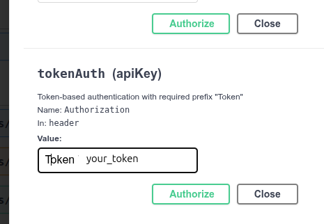

# build docker image
sudo docker-compose build

# adding new app module
sudo docker-compose run --rm sh -c "python manage.py startapp recipe"

# tests
sudo docker-compose run --rm app sh -c "python manage.py test"

# run migrations
docker-compose run --rm app sh -c "python manage.py makemigrations"

# linting
sudo docker-compose run --rm app sh -c "flake8"

# create super user
sudo docker-compose run --rm app sh -c "python manage.py createsuperuser"

# start server and apply migrations to server
sudo docker-compose up
# in browser test in swagger
127.0.0.1:8000/api/docs
## auth token

# created user
user: test_browser@example.com

Pass: Awesome!23

name: "Frank"

# admin
127.0.0.1/admin

admin@example.com

djangoadmin

# deployment on web server cmds
https://github.com/LondonAppDeveloper/build-a-backend-rest-api-with-python-django-advanced-resources/blob/main/deployment.md#install-and-configure-depdencies

# ssh to aws server (from ~/.ssh/)
ssh ec2-user@44.210.140.135
